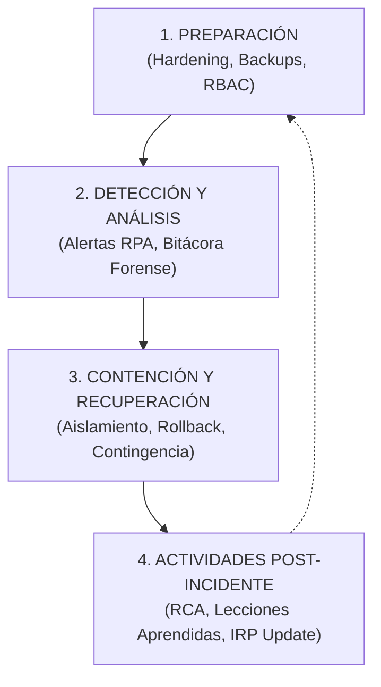

# PLAN DE RESPUESTA A INCIDENTES DE SEGURIDAD Y OPERACIONES (IRP)
## Incident Response Plan — Norma NIST SP 800-61 Rev. 2 / ISO/IEC 27035
### Sistema Autónomo de Gestión Operativa de Auditorios — Duoc UC
### Proyecto Capstone APT122 / PTY4614 — Benjamín Navarrete (Super Administrador)

---

## 1. OBJETIVO Y ALCANCE DEL PLAN (IRP)

El presente **Plan de Respuesta a Incidentes (IRP - Incident Response Plan)** establece el marco metodológico, técnico y procedimental para identificar, contener, erradicar y recuperarse ante incidentes operativos, fallas de infraestructura en la nube o ciberataques que amenacen la continuidad del servicio de auditorios y espacios académicos en Duoc UC.

El plan aplica de manera obligatoria sobre:
1. **La plataforma web desplegada en Vercel** (`https://sistema-gestion-auditorios-capstone.vercel.app`).
2. **El cluster de base de datos relacional en Neon Cloud PostgreSQL**.
3. **El entorno de contingencia local autónomo** (`http://localhost:3000` con SQLite).
4. **Los algoritmos y bots del motor RPA (Robotic Process Automation)**.
5. **Los dispositivos móviles del personal técnico de soporte TI en terreno**.

---

## 2. ESTRUCTURA DEL EQUIPO DE RESPUESTA A INCIDENTES (CSIRT / CIRT)

| Rol en el Plan | Responsable Institucional | Correo de Contacto | Responsabilidades Clave |
| :--- | :--- | :--- | :--- |
| **Comandante del Incidente (IC)** | **Benjamín Navarrete** | `benjamin54144752123@gmail.com` | Liderazgo técnico, toma de decisiones críticas, coordinación con Dirección y declaración de cierre de incidente. |
| **Líder de Soporte y Terreno** | Rodrigo Tapia | `soporte.ti@institucion.cl` | Ejecución de maniobras in situ, aislamiento de hardware averiado y activación de contingencia offline. |
| **Coordinadora de Recintos** | Carla Morales | `coordinacion@institucion.cl` | Comunicación con docentes afectados, reasignación de salas de respaldo y gestión logística. |
| **Cuadrillas de Apoyo (Aseo/Guardia)** | Cuadrillas Centrales | `aseo.central@institucion.cl` | Aseguramiento físico perimetral y sanitización de recintos alternativos. |

---

## 3. MATRIZ DE CLASIFICACIÓN Y SEVERIDAD DE INCIDENTES

| Nivel de Severidad | Tiempo Máximo de Respuesta (SLA) | Criterio de Clasificación | Escenario de Ejemplo |
| :---: | :---: | :--- | :--- |
| **SEV-1 (Crítico)** | **< 15 minutos** | Caída total de la plataforma en la nube o sospecha de filtración de credenciales / base de datos. | Caída global de Vercel/Neon Cloud o inyección maliciosa en producción. |
| **SEV-2 (Alto)** | **< 30 minutos** | Falla de hardware audiovisual principal en medio de un evento solemne o titulación. | Falla del proyector láser o de la consola de audio a minutos de iniciar una ceremonia. |
| **SEV-3 (Medio)** | **< 45 minutos** | Colisión de agenda no detectada, inasistencia docente masiva (No-Show) o desincronización de cuadrillas. | Docente no asiste sin avisar; el RPA no logra contactar a la guardia perimetral. |
| **SEV-4 (Bajo)** | **< 2 horas** | Olvido de credenciales de usuario individual o lentitud en conexiones externas. | Docente olvida su contraseña o solicita cambio de correo institucional. |

---

## 4. LAS 4 FASES DEL CICLO DE VIDA DE RESPUESTA A INCIDENTES (NIST SP 800-61)

### Fase 1: Preparación (Preparation)
* **Arquitectura Resiliente Dual:** El sistema cuenta con dos entornos de ejecución: producción serverless en **Neon PostgreSQL + Vercel** y respaldo local autónomo con **SQLite (`dev.db`)**, garantizando continuidad incluso ante caída total de internet.
* **Seguridad Embebida Defensiva:** Hasheo bcrypt (salt factor 10), protección nativa CSRF en Server Actions de Next.js y tipado estricto con validadores Zod.
* **Trazabilidad Forense Inmutable:** Cada transacción queda estampada en `RegistroAuditoria` con operador, marca temporal e IP.

### Fase 2: Detección y Análisis (Detection & Analysis)
* **Detección Automatizada por Bots RPA:**
  * El bot Anti No-Show detecta en $\le 30$ minutos si un recinto fue abandonado.
  * El bot de telemetría predictiva detecta hardware con fallas recurrentes ($\ge 2$ ingresos a taller en 30 días).
* **Inspección de Logs Forenses:** El Super Administrador cuenta con la pestaña de **Bitácora de Auditoría** y el visor individual de logs por cuenta para detectar patrones anómalos o intentos no autorizados.

### Fase 3: Contención, Erradicación y Recuperación (Containment, Eradication & Recovery)
* **Contención Inmediata:**
  * Si una cuenta presenta actividad sospechosa: El Super Administrador utiliza el **Gestor de Cuentas** para cambiar su rol o restablecer su clave con doble verificación.
  * Si un auditorio o equipo sufre avería: Se activa el botón **`Cambiar Estado Auditorio`** en el *Dashboard de Salud*, pausando de inmediato la agenda y bloqueando reservas de stock dañado.
* **Erradicación:**
  * Depuración de reservas en conflicto o retiro físico de hardware a servicio técnico.
* **Recuperación:**
  * Restauración del servicio en la nube o conmutación rápida al servidor local de respaldo mediante el lanzador [`INICIAR_PROTOTIPO_FASE2.bat`](file:///c:/Users/MAANDO/Desktop/PROYECTO%20DE%20TITULO/INICIAR_PROTOTIPO_FASE2.bat).

### Fase 4: Actividades Post-Incidente y Lecciones Aprendidas (Post-Incident Activity)
* **Análisis de Causa Raíz (RCA - Root Cause Analysis):** Reunión del equipo técnico en menos de 24 horas tras incidentes SEV-1 o SEV-2.
* **Constancia Técnica Obligatoria:** No se permite reactivar un equipo o auditorio sin registrar la solución técnica aplicada en el formulario de resolución de novedades.
* **Actualización del IRP:** Si se descubrió un nuevo vector de falla, se actualizan las reglas de los bots RPA.

---

## 5. PROTOCOLOS ESTANDARIZADOS DE ACCIÓN INMEDIATA (RUNBOOKS)

### Runbook 1: Caída de Conexión a Internet durante una Ceremonia
1. El técnico en terreno no entra en pánico; solicita al docente el código alfanumérico visible bajo el código QR (ej: `qr-res-001`).
2. En la laptop del auditorio, abre el acceso local de respaldo: `http://localhost:3000`.
3. Valida el Check-in localmente; la base de datos SQLite procesa la apertura sin requerir internet.
4. Al restablecerse el enlace de red, las métricas se sincronizan con Neon Cloud.

### Runbook 2: Sospecha de Acceso No Autorizado a una Cuenta
1. El Super Administrador ingresa a `/admin` $
ightarrow$ pestaña `Gestión de Cuentas`.
2. Pulsa el botón `Logs` de la cuenta afectada y analiza los accesos recientes.
3. Pulsa el botón `Clave`, marca la doble verificación y asigna una nueva contraseña temporal segura.
4. Si la cuenta fue comprometida gravemente, modifica su rol a `PROFESSOR` o elimina su acceso temporalmente.

### Runbook 3: Falla Técnica Repentina en Hardware Audiovisual
1. El técnico reporta la falla al administrador.
2. El administrador ingresa a `/admin` $
ightarrow$ `Salud y Mantenimiento` $
ightarrow$ `Registrar Novedad`.
3. Pone el implemento en estado `EN_MANTENCION` con severidad `ALTA`.
4. El sistema automáticamente decrementa el stock disponible a 0 y previene nuevas solicitudes.
5. El técnico provee el equipo de reemplazo de contingencia del pañol.

---
*Plan de Respuesta a Incidentes — Escuela de Informática y Telecomunicaciones — Duoc UC 2026*
