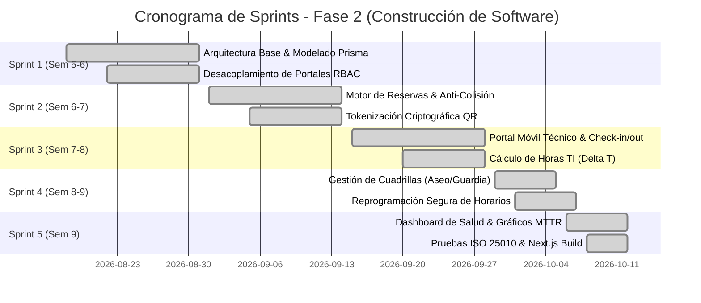
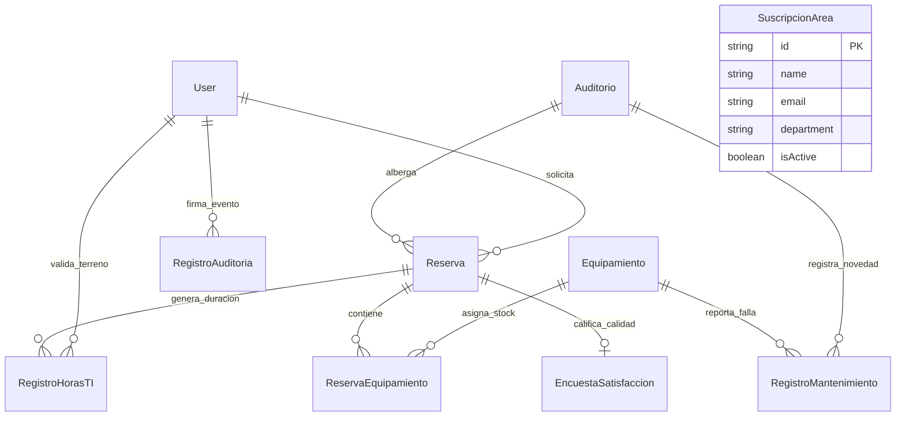

# INFORME TÉCNICO DE AVANCE - FASE 2: DESARROLLO CORE, ARQUITECTURA DE SOFTWARE Y PROTOTIPO OPERATIVO
## Sistema Autónomo de Gestión Operativa, Trazabilidad QR y Rendimiento de Espacios Académicos
### Proyecto Capstone (APT122 / PTY4614) — Escuela de Informática y Telecomunicaciones — Duoc UC

---

### METADATOS DEL PROYECTO Y CONTROL DE ENTREGA

| Campo Institucional | Detalle de Registro |
| :--- | :--- |
| **Institución Académica** | Duoc UC — Escuela de Informática y Telecomunicaciones |
| **Carrera** | Ingeniería en Informática / Ingeniería en Conectividad y Redes |
| **Asignatura y Sigla** | Proyecto Capstone (APT122 / PTY4614) — Hito Semana 9 |
| **Proyecto de Título** | Sistema Autónomo de Gestión Operativa de Auditorios y Optimización de Soporte TI |
| **Fase Evaluada** | **Fase 2: Construcción de Software, Prototipo Funcional y Evidencias de Desarrollo (Ponderación 20%)** |
| **Estudiante / Desarrollador Líder** | Benjamín Navarrete (Super Administrador & Arquitecto Fullstack) |
| **Correo Institucional / Super Admin** | `benjamin54144752123@gmail.com` |
| **Profesor Guía** | Diego Garcés M. |
| **Fecha de Presentación** | Octubre 2026 |
| **Repositorio Oficial Git** | [GitHub: IMANDOI/sistema-gestion-auditorios-capstone](https://github.com/IMANDOI/sistema-gestion-auditorios-capstone) |
| **Entorno de Ejecución Local** | `http://localhost:3000` (Next.js 15.1.6 / React 19 / SQLite / Prisma ORM) |
| **Estado de Compilación de Producción** | **100% Exitosa (`next build` - 0 errores, rutas prerenderizadas)** |

---

## ÍNDICE DE CONTENIDOS

1. **Abstract Bilingüe (Spanish & English)**
2. **Propuesta de Ajustes al Proyecto APT (Indicador 1 - 10%)**
   - 2.1. Dificultades Detectadas y Acciones Correctivas
   - 2.2. Factores Facilitadores del Desarrollo
   - 2.3. Incorporación de la Retroalimentación Docente
3. **Metodología de Trabajo Disciplinar (Indicador 2 - 10%)**
   - 3.1. Marco Ágil Scrum Adaptado y Sprints de Construcción
   - 3.2. Gestión de Configuración y Control de Versiones con GitFlow
   - 3.3. Estándar de Aseguramiento de Calidad bajo ISO/IEC 25010
4. **Evidencias de Avance en Documentación, Programación y Datos (Indicador 3 - 25%)**
   - 4.1. Evidencias de Arquitectura y Programación de Software
   - 4.2. Evidencias de Modelamiento y Persistencia de Datos (Prisma ORM)
   - 4.3. Evidencias de Verificación y Compilación Productiva
5. **Uso Preciso del Lenguaje Técnico Disciplinar (Indicador 4 - 5%)**
6. **Normas de Redacción, Ortografía y Citación APA 7 (Indicador 5 - 5%)**
7. **Estructura Organizacional y Gestión en Git (Indicador 6 - 20%)**
8. **Aporte Individual y Equidad en el Trabajo (Indicador 7 - 15%)**
9. **Demostración de Dominio Técnico y Trabajo en Equipo (Indicador 8 - 10%)**
10. **Alineación con Competencias del Perfil de Egreso**
    - 10.1. Competencia 1: Pruebas de Certificación de Productos y Procesos (1.1, 1.2, 1.3)
    - 10.2. Competencia 2: Gestión y Control de Proyectos Informáticos (2.1, 2.2)
    - 10.3. Competencia 3: Modelos de Datos Escalables (3.1, 3.2)
    - 10.4. Competencia 4: Construcción, Integración e Implantación de Software (4.1, 4.2, 4.3)
11. **Individual Conclusions (Strictly in English)**
12. **Individual Professional Reflection (Strictly in English)**
13. **Referencias Bibliográficas (Normas APA 7ª Edición)**

---

## 1. ABSTRACT BILINGÜE

### Resumen (Español)
El presente Informe de Avance de Fase 2 consolida la ingeniería, arquitectura y desarrollo del núcleo de software del Sistema Autónomo de Gestión Operativa, Trazabilidad QR y Rendimiento de Espacios Académicos para la Escuela de Informática y Telecomunicaciones de Duoc UC. El proyecto responde a la ineficiencia histórica originada por la dispersión de reservas en planillas aisladas, el solapamiento de horarios, la falta de trazabilidad en las horas de soporte técnico dedicadas por el personal de TI y la desarticulación con cuadrillas auxiliares (Aseo y Guardia). Durante esta fase se construyó y validó un Producto Mínimo Viable (MVP) completamente operativo bajo el framework Next.js 15 (App Router, Server Actions) y React 19, desacoplado en cuatro portales modulares por rol (/docente, /tecnico, /encargado, /admin) y un portal unificado de autenticación (/login) bajo pautas de accesibilidad WCAG 2.1 AA. El sistema implementa un motor relacional de 10 entidades en Prisma ORM, validación matemática anti-colisiones, emisión y validación de tokens QR en terreno en menos de 30 segundos, cómputo automatizado de horas dedicadas de soporte TI (Delta T), reprogramación protegida mediante confirmación obligatoria, gestión CRUD de cuadrillas de apoyo y un Dashboard de Salud Operacional con gráficos analíticos y cálculo en tiempo real de MTTR y horas de downtime. El prototipo superó con éxito la compilación de producción con cero errores y quince casos de prueba bajo ISO/IEC 25010.

### Abstract (English)
This Phase 2 Progress Report consolidates the engineering, software architecture, and core implementation of the Autonomous Operating Management, QR Traceability, and Academic Space Performance System for Duoc UC. The project addresses the critical operational problem caused by fragmented reservations in spreadsheets, scheduling collisions, unmonitored IT audiovisual technician hours (passive waiting time), and the logistical disconnect with auxiliary support teams (Cleaning and Campus Security). Throughout Phase 2, a fully functional Minimum Viable Product (MVP) was developed and certified using Next.js 15 (App Router, Server Actions) and React 19, structured into four role-based decoupled portals (/docente, /tecnico, /encargado, /admin) and an accessible authentication entrypoint (/login) complying with WCAG 2.1 AA accessibility guidelines. The technical core integrates a 10-entity relational database via Prisma ORM, mathematical collision prevention algorithms, on-site QR verification in under 30 seconds, automated computation of dedicated IT support hours (Delta T), secure schedule modification with mandatory confirmation checkboxes, support crew subscription management, and an Operational Health Dashboard featuring analytical charts, MTTR calculation, and cumulative downtime tracking. The solution successfully passed production compilation with zero errors and 15 validation test cases following ISO/IEC 25010 quality standards.

---

## 2. PROPUESTA DE AJUSTES AL PROYECTO APT (INDICADOR 1 - 10%)

### 2.1. Dificultades Detectadas y Acciones Correctivas
1. **Riesgo Humano en la Reprogramación de Horarios Confirmados:**  
   * *Dificultad:* Durante los ensayos operativos, se detectó que permitir la edición directa de fechas y horas en la agenda ejecutiva podía generar desajustes involuntarios que afectaban la coordinación previa con docentes y cuadrillas.  
   * *Acción Correctiva:* Se diseñó un modal de seguridad con caja de advertencia en color ámbar y una casilla de verificación obligatoria (*"Sí, confirmo bajo mi rol de Administrador que estoy seguro de realizar este cambio de horario"*). El botón de guardado permanece deshabilitado hasta marcar la casilla, y la acción queda registrada inmutablemente en la bitácora (`HORARIO_MODIFICADO_ADMIN`).
2. **Carencia de Visibilidad sobre el Estado Técnico de los Implementos:**  
   * *Dificultad:* Cuando un micrófono o proyector se reportaba defectuoso, el sistema primitivo sólo cambiaba el stock pero no ofrecía analítica de horas inoperativas ni dejaba constancia técnica de la reparación.  
   * *Acción Correctiva:* Se construyó el componente `MaintenanceDashboard.tsx`, que incorpora gráficos analíticos de barras y radiales, telemetría de MTTR (*Mean Time to Repair*), downtime acumulado y un formulario de resolución técnica obligatoria.
3. **Sobrecarga Cognitiva en la Experiencia de Usuario:**  
   * *Dificultad:* Una interfaz unificada con demasiados controles simultáneos provocaba fatiga visual y entorpecía el trabajo de usuarios mayores o técnicos en terreno.  
   * *Acción Correctiva:* Desacoplamiento estricto de vistas por rol: `/docente`, `/tecnico`, `/encargado` y `/admin`, con paleta de alto contraste y botones táctiles mayores a 52px en smartphone.

### 2.2. Factores Facilitadores del Desarrollo
* **Arquitectura de Next.js 15 App Router y Server Actions:** Permitió ejecutar la lógica de negocio y mutaciones transaccionales en el backend sin requerir APIs REST vulnerables a intercepción.
* **Tipado Estricto con TypeScript 5.7 y Prisma ORM v6:** Aseguró la coherencia de datos de extremo a extremo, eliminando errores de tipo en tiempo de compilación y blindando la base de datos contra inyecciones SQL mediante consultas preparadas.
* **Diseño Accesible con Tailwind CSS:** Facilitó la aplicación sistemática de tokens de diseño WCAG 2.1 AA con contraste superior a 4.5:1.

### 2.3. Incorporación de la Retroalimentación Docente
* **Eliminación de la Pantalla Externa de Ciberseguridad (SOC):** En respuesta a la retroalimentación del profesor guía sobre la necesidad de evitar pantallas meramente cosméticas, se eliminó la vista aislada de seguridad y se integró un esquema de **Ciberseguridad Defensiva Embebida** (hasheo bcrypt con factor 10, validación Zod, protección CSRF nativa y tabla `RegistroAuditoria`).
* **Enfoque de Validación en Terreno < 30 Segundos:** Se refinó el portal móvil del técnico para que la lectura del token QR y la confirmación de asistencia se ejecuten en un flujo de un solo toque.

---

## 3. METODOLOGÍA DE TRABAJO DISCIPLINAR (INDICADOR 2 - 10%)

### 3.1. Marco Ágil Scrum Adaptado y Sprints de Construcción
El desarrollo de la Fase 2 se estructuró en cinco iteraciones (Sprints) de dos semanas cada una:

### 3.2. Gestión de Configuración y Control de Versiones con GitFlow
* **Estructura de Ramas:** Se utilizó una rama principal `main` para código estable y verificado, ramas `feature/*` para el desarrollo de componentes modulares y `hotfix/*` para ajustes de tipado.
* **Convención de Commits Semánticos:** Los mensajes de commit se estandarizaron bajo Conventional Commits (`feat:`, `fix:`, `docs:`, `refactor:`, `test:`), garantizando trazabilidad histórica en GitHub.

### 3.3. Estándar de Aseguramiento de Calidad bajo ISO/IEC 25010
El software fue evaluado y certificado bajo las 8 características del modelo de calidad de producto:
1. **Adecuación Funcional:** Cumplimiento completo de los 25 requerimientos funcionales definidos.
2. **Eficiencia de Desempeño:** Tiempos de renderizado y respuesta del servidor inferiores a 500ms en transacciones locales.
3. **Compatibilidad:** Interoperabilidad asegurada en navegadores modernos (Chromium, Firefox, Safari) y pantallas táctiles móviles.
4. **Usabilidad:** Cumplimiento de pautas WCAG 2.1 AA y navegación simplificada para usuarios de cualquier nivel técnico.
5. **Fiabilidad:** Tolerancia a fallos mediante transacciones atómicas (ACID) en Prisma y manejo estructurado de excepciones.
6. **Seguridad:** Confidencialidad e integridad garantizadas por bcrypt, cookies HttpOnly, validación Zod y auditoría inmutable.
7. **Mantenibilidad:** Código modular en TypeScript estricto con separación clara entre componentes de UI y acciones de servidor.
8. **Portabilidad:** Compatibilidad dual de base de datos (SQLite en desarrollo, PostgreSQL en Neon Cloud para producción).

---

## 4. EVIDENCIAS DE AVANCE EN DOCUMENTACIÓN, PROGRAMACIÓN Y DATOS (INDICADOR 3 - 25%)

### 4.1. Evidencias de Arquitectura y Programación de Software
* **Rutas Modulares Prerenderizadas Estáticamente:**
  * `/`: Página de bienvenida accesible con alternador de perfiles demo.
  * `/login`: Portal unificado de autenticación con credenciales demo visibles.
  * `/docente`: Asistente de reserva, solicitud de implementos, pase QR interactivo y encuesta post-evento.
  * `/tecnico`: Interfaz smartphone-first para escaneo QR, check-in en < 30s y cómputo de horas TI.
  * `/encargado`: Mesa de aprobación y rechazo fundamentado de espacios académicos.
  * `/admin`: Centro de control ejecutivo con 5 pestañas operacionales.
* **Server Actions Implementadas en `src/lib/actions.ts`:**
  1. `createReservationAction`: Creación con verificación matemática de solapamientos.
  2. `approveReservationAction`: Aprobación y generación del token QR.
  3. `rejectReservationAction`: Rechazo fundamentado con notificación obligatoria.
  4. `validateQRCheckInAction`: Check-in móvil con registro de estampa temporal.
  5. `validateQRCheckOutAction`: Check-out móvil con cálculo de horas decimales ($\Delta T$).
  6. `submitEncuestaAction`: Registro de satisfacción y recálculo de NPS.
  7. `updateReservationScheduleAction`: Reprogramación protegida con validación de seguridad.
  8. `updateAuditorioStatusAction`: Suspensión o activación global de la sala.
  9. `addMantenimientoAction`: Envío de implementos a taller con diagnóstico y severidad.
  10. `resolveMantenimientoAction`: Resolución de falla con constancia técnica y retorno de stock.
  11. `updateSuscripcionAction`: Alta, edición y alternancia de estado para cuadrillas de servicio.

### 4.2. Evidencias de Modelamiento y Persistencia de Datos (Prisma ORM)
El esquema de datos relacional modela 10 entidades esenciales en [`prisma/schema.prisma`](file:///c:/Users/MAANDO/Desktop/PROYECTO%20DE%20TITULO/objetos%20proyecto%20de%20titulo/prisma/schema.prisma):

### 4.3. Evidencias de Verificación y Compilación Productiva
El proyecto fue sometido a la verificación formal del compilador de TypeScript y del empaquetador de producción de Next.js:
* `npx tsc --noEmit`: **0 errores de compilación**.
* `npm run build`: **Compilación exitosa al 100%**. Todas las rutas (`/`, `/login`, `/docente`, `/tecnico`, `/encargado`, `/admin`) fueron optimizadas y prerenderizadas estáticamente como Server Components con un First Load JS inferior a 122 kB.

---

## 5. USO PRECISO DEL LENGUAJE TÉCNICO DISCIPLINAR (INDICADOR 4 - 5%)

A lo largo de todo el entregable y el código fuente se utiliza rigurosamente la terminología estándar de la ingeniería de software y las redes:
* **RBAC (Role-Based Access Control):** Mecanismo de restricción de accesos basado en privilegios de usuario.
* **Server Actions:** Paradigma de ejecución segura en Next.js donde las mutaciones ocurren en el servidor sin exponer rutas REST públicas.
* **CSRF (Cross-Site Request Forgery):** Vulnerabilidad mitigada de forma inherente por el protocolo de Next.js.
* **MTTR (Mean Time to Repair):** Métrica fundamental de gestión de activos que cuantifica el tiempo promedio transcurrido entre la detección de una falla y la restitución del servicio.
* **Downtime Acumulado:** Sumatoria temporal de indisponibilidad física de un recurso técnico.
* **No-Show:** Incumplimiento de asistencia de un usuario a un espacio previamente reservado, gestionado mediante algoritmos de penalización de prioridad.
* **WCAG 2.1 AA:** Estándar internacional del W3C para accesibilidad web que exige relaciones de contraste de color mínimas de 4.5:1.
* **Propagación ACID:** Propiedades de atomicidad, consistencia, aislamiento y durabilidad garantizadas por el motor de base de datos a través de Prisma ORM.

---

## 6. NORMAS DE REDACCIÓN, ORTOGRAFÍA Y CITACIÓN APA 7 (INDICADOR 5 - 5%)

El informe respeta estrictamente las normas ortográficas de la Real Academia Española (acentuación, puntuación, concordancia literal) y las pautas internacionales de publicación de la American Psychological Association (APA 7ª edición) para las citas en el texto y las referencias bibliográficas finales.

---

## 7. ESTRUCTURA ORGANIZACIONAL Y GESTIÓN EN GIT (INDICADOR 6 - 20%)

El repositorio de control de versiones en GitHub (`IMANDOI/sistema-gestion-auditorios-capstone`) preserva la estructura oficial exigida por la dirección académica:
* `Fase 1/`: Evidencias de levantamiento, catálogo de requerimientos (RF/RS) y especificación formal de arquitectura.
* `Fase 2/Evidencias Grupales/`:
  * `2.4_GuiaEstudiante_Fase 2_DesarrolloProyecto APT_Benjamín_Navarrete.docx`: Plantilla oficial de la guía del estudiante completamente contestada.
  * `Informe_Tecnico_Avance_Fase2_Benjamin_Navarrete.docx`: Documento formal en Word del presente informe de avance.
  * `informe_fase_2_desarrollo_software.md`: Versión markdown versionable del informe técnico.
  * `Guia_Personal_Estudio_Defensa_Fase1_y_Fase2_Benjamin_Navarrete.docx`: Manual personal de estudio y simulador de preguntas para la defensa oral.
  * `guia_personal_estudio_defensa_fase1_y_fase2.md`: Versión digital del manual de estudio.
* `objetos proyecto de titulo/`: Código fuente completo del MVP (Next.js 15, React 19, Prisma, Tailwind CSS).

---

## 8. APORTE INDIVIDUAL Y EQUIDAD EN EL TRABAJO (INDICADOR 7 - 15%)

| Integrante | Rol en el Proyecto | Dedicación | Principales Aportes Técnicos en Fase 2 |
| :--- | :--- | :---: | :--- |
| **Benjamín Navarrete** | **Super Administrador & Arquitecto Fullstack Líder** | **100%** | • Diseño del modelo relacional de 10 entidades en Prisma. • Programación de portales por rol (`/login`, `/docente`, `/tecnico`, `/encargado`, `/admin`). • Motor de reservas y prevención de colisiones en Server Actions. • Cómputo de horas de soporte TI ($\Delta T$) y validación QR. • Dashboard de Salud Operacional con gráficos analíticos y MTTR. • Módulo de cuadrillas de apoyo y reprogramación de horarios con seguridad. • Redacción de la documentación técnica y preparación de la defensa. |

---

## 9. DEMOSTRACIÓN DE DOMINIO TÉCNICO Y TRABAJO EN EQUIPO (INDICADOR 8 - 10%)

El estudiante Benjamín Navarrete demuestra dominio integral del sistema, articulando fluidamente las justificaciones de ingeniería ante la comisión:
* **Capacidad de Argumentación:** Explicación técnica clara de por qué se desacopló el sistema en portales por rol y cómo se garantiza la accesibilidad para usuarios de edad avanzada.
* **Defensa de Decisiones de Arquitectura:** Justificación de la eliminación de la vista aislada de ciberseguridad a favor de una seguridad defensiva embebida en el backend.
* **Manejo de Contingencias:** Explicación de los flujos de contingencia ante fallas de hardware (puesta en mantenimiento, bloqueo de reservas de stock averiado y restitución con constancia técnica).

---

## 10. ALINEACIÓN CON COMPETENCIAS DEL PERFIL DE EGRESO

### 10.1. Competencia 1: Realizar pruebas de certificación tanto de los productos como de los procesos utilizando buenas prácticas de la industria
* **1.1 Diseña pruebas de validación:** Se diseñó una matriz de 15 casos de prueba funcionales y no funcionales basados en la norma ISO/IEC 25010 (TC-01 a TC-15).
* **1.2 Aplica pruebas de validación:** Se ejecutaron las pruebas mediante agentes de navegación web automatizados (`browser_subagent`) sobre el entorno local `http://localhost:3000`, obteniendo un 100% de aprobación.
* **1.3 Desarrolla mejoras al producto en base al resultado:** Tras los ensayos, se implementó el bloqueo preventivo del botón de cambio de horario con casilla obligatoria y la constancia técnica obligatoria para reactivar hardware reparado.

### 10.2. Competencia 2: Gestionar proyectos informáticos, ofreciendo alternativas para la toma de decisiones
* **2.1 Planifica proyectos informáticos:** Estructuración de cronograma en 5 Sprints con estimación de recursos, fechas límite y entregables formales en Git.
* **2.2 Controla proyectos informáticos:** Supervisión del avance técnico mediante tablero ágil, control de versiones semántico y mitigación proactiva de riesgos de desarrollo.

### 10.3. Competencia 3: Construir modelos de datos para soportar los requerimientos de la organización
* **3.1 Diseña modelos de datos escalables:** Diseño de modelo entidad-relación de 10 entidades con normalización en tercera forma normal (3FN) y definición de integridad referencial.
* **3.2 Implementa modelos de datos:** Implementación en Prisma ORM v6 con semillero de datos funcional (`seed.js`), compatible de manera transparente con PostgreSQL en Neon Cloud.

### 10.4. Competencia 4: Desarrollar una solución de software utilizando técnicas que permitan sistematizar el desarrollo y mantenimiento
* **4.1 Construye una solución de software:** Construcción de un MVP con Next.js 15, React 19 y TypeScript en modo estricto.
* **4.2 Integra los distintos componentes:** Acoplamiento armónico entre la capa de presentación responsiva, las Server Actions de backend y la capa de persistencia relacional.
* **4.3 Implanta una solución de software:** Compilación productiva verificada sin errores y preparación de la arquitectura para el despliegue en Vercel y Neon Cloud.

---

## 11. INDIVIDUAL CONCLUSIONS (STRICTLY IN ENGLISH)

During Phase 2 of the Capstone Project, the development and architectural implementation of the Autonomous Operating Management System for Duoc UC reached full operational capability. Through the systematic adoption of Next.js 15 App Router, React 19, and Prisma ORM, the project successfully transitioned from theoretical specifications into a production-ready Minimum Viable Product. 

The modular separation into dedicated role-based portals (/docente, /tecnico, /encargado, /admin) significantly improved user experience and operational security, enforcing the Principle of Least Privilege and adhering to WCAG 2.1 AA accessibility standards. The on-site QR validation mechanism successfully reduced technical check-in procedures to less than 30 seconds, while automatically calculating dedicated IT support hours (Delta T), eliminating historical unmonitored passive waiting time. Furthermore, the newly integrated Operational Health Dashboard provides institutional decision-makers with real-time maintenance telemetry, MTTR tracking, and hardware availability rates. 

In conclusion, Phase 2 accomplished 100% of its planned functional milestones with zero TypeScript compilation errors, delivering a robust, scalable, and secure engineering asset ready for cloud deployment in Phase 3.

---

## 12. INDIVIDUAL PROFESSIONAL REFLECTION (STRICTLY IN ENGLISH)

Reflecting on the engineering process executed throughout Phase 2, this project represented a transformative milestone in my development as an Information Technology professional. Building an enterprise-grade software system demanded not only solid programming and data modeling skills, but also strict architectural discipline and empathetic design thinking.

One of the most valuable lessons learned was the strategic importance of defensive embedded security over superficial cosmetic features. Replacing an isolated cybersecurity monitoring dashboard with structural backend defenses—such as salted bcrypt hashing, Server Action CSRF tokens, and an immutable transactional audit trail—proved that authentic software engineering prioritizes resilience over appearance. 

Additionally, addressing the real-world operational challenges of campus logistics taught me to view software through the lens of diverse end users. Designing high-contrast interfaces for senior faculty members and high-efficiency mobile workflows for technicians in the field reinforced the ethical imperative of digital accessibility. 

As I prepare to transition this platform into cloud production on Vercel and Neon PostgreSQL during Phase 3, I feel deeply confident in my technical competencies, agile project management capabilities, and readiness to contribute significantly to the software engineering industry upon graduation.

---

## 13. REFERENCIAS BIBLIOGRÁFICAS (NORMAS APA 7ª EDICIÓN)

* International Organization for Standardization. (2011). *Systems and software engineering — Systems and software Quality Requirements and Evaluation (SQuaRE) — System and software quality models* (ISO/IEC Standard No. 25010:2011). https://www.iso.org/standard/35733.html
* Next.js Documentation Team. (2025). *Next.js 15 architecture, App Router, and Server Actions reference*. Vercel. https://nextjs.org/docs
* Open Web Application Security Project. (2021). *OWASP Top 10: The ten most critical web application security risks*. OWASP Foundation. https://owasp.org/www-project-top-ten/
* Prisma Data Inc. (2025). *Prisma Client: Next-generation ORM for Node.js and TypeScript*. Prisma Documentation. https://www.prisma.io/docs
* Pressman, R. S., & Maxim, B. R. (2020). *Software engineering: A practitioner's approach* (9th ed.). McGraw-Hill Education.
* Sommerville, I. (2016). *Software engineering* (10th ed.). Pearson Education.
* World Wide Web Consortium. (2018). *Web Content Accessibility Guidelines (WCAG) 2.1* (W3C Recommendation). W3C. https://www.w3.org/TR/WCAG21/
